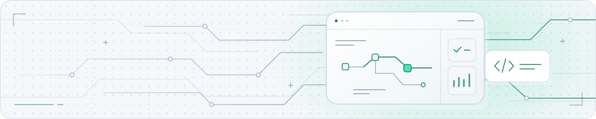
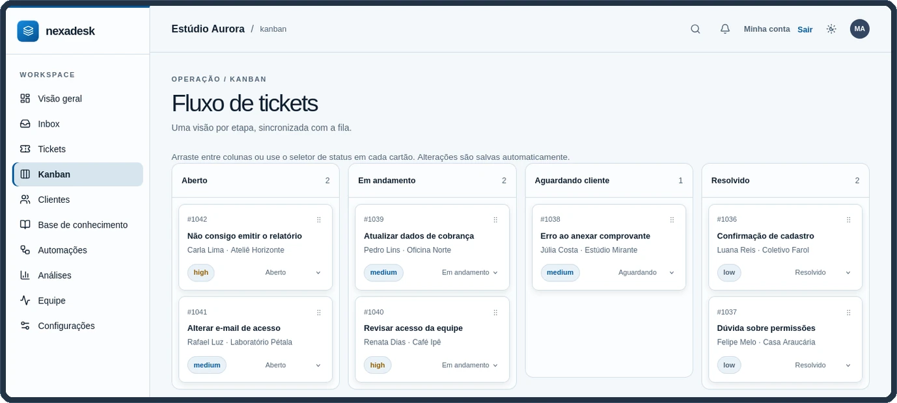
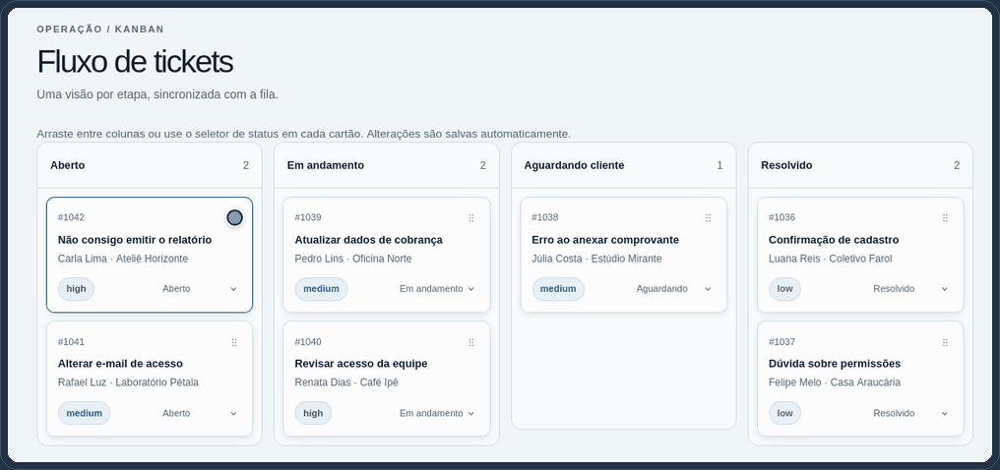
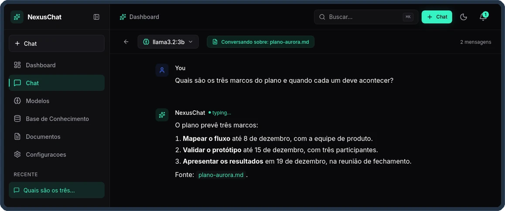
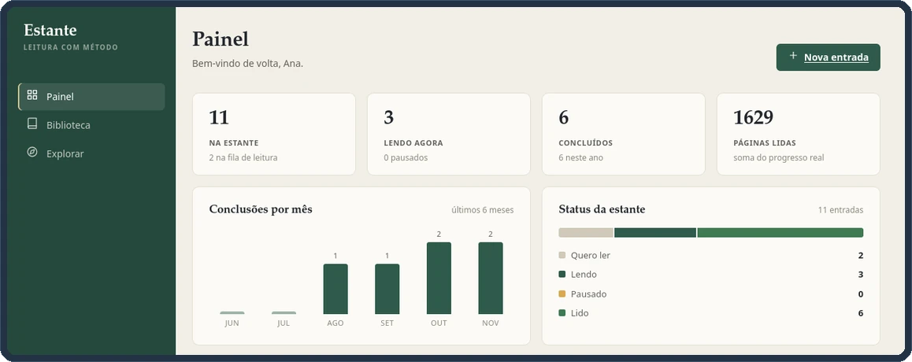

<picture>
  <source media="(prefers-color-scheme: dark)" srcset="./assets/profile/banner-dark.svg">
  <source media="(prefers-color-scheme: light)" srcset="./assets/profile/banner-light.svg">
  
</picture>

# Matheus Santos

**Engenheiro de Software**

Construo aplicações web com foco em back-end, dados e integrações de IA local.

[**Portfólio**](https://mthsantos.vercel.app) &nbsp;·&nbsp; [**LinkedIn**](https://linkedin.com/in/mthsantos061) &nbsp;·&nbsp; [**E-mail**](mailto:mmarinhods@gmail.com)

## Projetos em destaque

### NexaDesk · Central de atendimento

Criei uma central de atendimento que roda localmente. A equipe organiza solicitações em filas e no Kanban, registra respostas e controla o acesso por papel.

**Testes de integração** exercitam o fluxo de atendimento e verificam quem pode acessar notas internas e anexos.

**Stack** · Next.js · TypeScript · PostgreSQL

[**Ver código**](https://github.com/mmarinhods-cloud/nexadesk) · [Ver teste de integração](https://github.com/mmarinhods-cloud/nexadesk/blob/main/tests/workflows.integration.mjs)

Ver o fluxo em ação

### NexusChat · Conversas com IA local

Criei uma interface para conversar com modelos rodando no Ollama e consultar documentos sem precisar carregar o texto manualmente a cada pergunta. As respostas aparecem em streaming.

Na **rota de chat**, recupero o conteúdo do documento selecionado e o adiciono ao contexto enviado ao modelo.

**Stack** · Next.js · TypeScript · Ollama · PostgreSQL · Prisma

[**Ver código**](https://github.com/mmarinhods-cloud/nexuschat) · [Ver rota de chat](https://github.com/mmarinhods-cloud/nexuschat/blob/main/src/app/api/chat/route.ts)

*Captura com documento fictício e resposta de teste.*

### Estante · Acompanhamento de leitura

Criei um acervo pessoal para importar livros do Google Books e da Open Library, registrar o progresso e acompanhar o ritmo de leitura.

Busco nos **dois catálogos em paralelo**. Se um falha, a busca exibe os resultados do outro e informa a falha parcial.

**Stack** · Angular · TypeScript · RxJS

[**Ver código**](https://github.com/mmarinhods-cloud/Estante) · [Ver busca nos catálogos](https://github.com/mmarinhods-cloud/Estante/blob/main/src/app/features/explore/explore-page.ts)

Outros projetos

- [**TaskTracker**](https://github.com/mmarinhods-cloud/tasktracker) · Gerenciador de tarefas em Python com validação de entradas e testes automatizados.
- [**Matheus Browser**](https://github.com/mmarinhods-cloud/Navegador-python) · Navegador desktop em Python e PyQt6 com abas e favoritos.

## Tecnologias

**Back-end e dados**

  &nbsp;Node.js&nbsp;
  &nbsp;PostgreSQL&nbsp;
  &nbsp;Prisma&nbsp;
  &nbsp;Python

**Interfaces**

  &nbsp;TypeScript&nbsp;
  &nbsp;Next.js&nbsp;
  &nbsp;React&nbsp;
  &nbsp;Angular

**IA local**

  &nbsp;Ollama

**Aprofundando agora** · FastAPI, AWS e aplicações com LLMs.

## Sobre mim

Sou formado em **Análise e Desenvolvimento de Sistemas** e curso **Ciência da Computação**. Me interesso pela engenharia por trás dos produtos, especialmente APIs, modelagem de dados e integração de IA.

Atividade no GitHub

